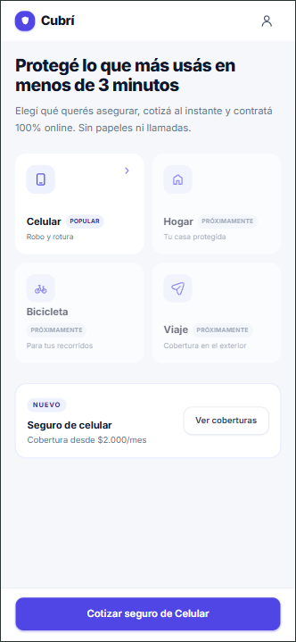
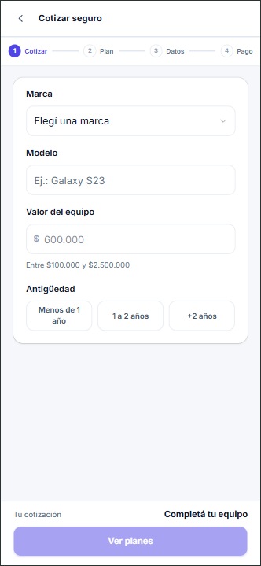
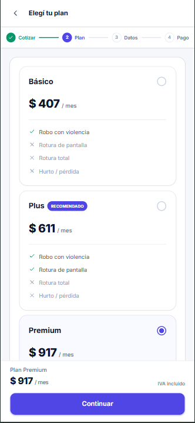
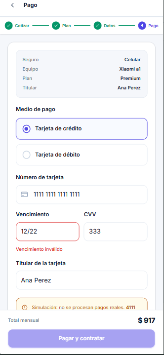
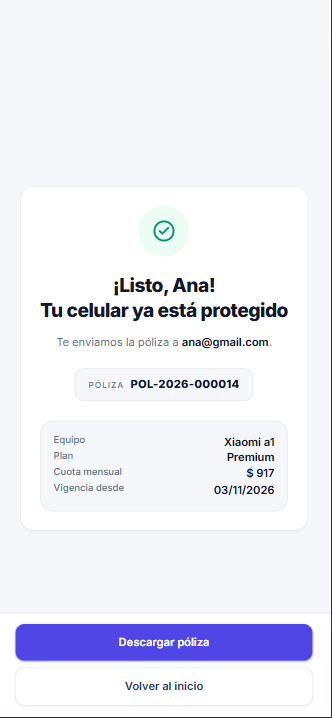

# TP5 Cubrí — Seguro de celular
Materia Diseño UX-UI - Uader FCyT - 
Velzi Maria Cecilia

Prototipo frontend de un flujo de contratación digital de seguro para celulares. Permite cotizar un equipo, comparar planes, ingresar los datos del titular y simular un pago. La interfaz es responsive, está pensada para mobile y desktop y basada en el prototipo de diseño dado de Figma (https://www.figma.com/design/vJrfOUfiOI7OSeTtRfCloh)

> **Demo académica:** no tiene backend ni procesa pagos reales. Usá únicamente los números de tarjeta de prueba indicados abajo; nunca ingreses datos reales.

## Demo publicada

**URL:** 

## Cómo correr el proyecto

Requisitos: Node.js y npm.

```bash
npm install
npm run dev
```

Abrí en el navegador la dirección local que indique Vite en la terminal.

## Flujo y funcionalidades

El checkout se implementa en una sola página, con las secciones de cada etapa que se muestran según el estado de la solicitud:

1. **Inicio:** selección del seguro de celular.
2. **Cotización:** marca, modelo, valor y antigüedad del equipo.
3. **Plan:** comparación de Básico, Plus y Premium.
4. **Datos:** información del titular y aceptación de términos.
5. **Pago:** método y datos de tarjeta; el resumen acompaña al usuario.
6. **Éxito:** confirmación, número de póliza y resumen de la contratación.
7. **Error:** resultado de pago rechazado, con opción para reintentar o cambiar el medio de pago.

Los planes se cargan desde `public/data/planes.json`. La cuota se calcula con la fórmula `valor × tasa anual × factor de antigüedad ÷ 12`, redondeada al entero más cercano. Por ejemplo, para un equipo de $600.000 con menos de un año de antigüedad: Básico $2.000, Plus $3.000 y Premium $4.500 por mes.

Los formularios validan sus campos antes de avanzar y muestran mensajes junto a cada error. El pago es una simulación: `4111 1111 1111 1111` se aprueba y `4000 0000 0000 0002` se rechaza; cualquier otra tarjeta válida de 16 dígitos se aprueba también. La simulación tarda aproximadamente 1,5 segundos.

## Decisiones de implementación

- Se usó HTML, JavaScript vanilla, Tailwind CSS v4 y Basecoat CSS, sin frameworks de UI ni backend.
- Vite gestiona el servidor de desarrollo y la compilación; la configuración usa rutas relativas para facilitar el despliegue en subdirectorios.
- El objeto `solicitud` en `src/estado.js` centraliza los datos y el paso actual. `src/render.js` actualiza las vistas a partir de ese estado; `src/main.js` conecta eventos y navegación.
- La lógica de cálculo, validación y simulación de pago está separada en `src/cotizador.js`, `src/validaciones.js` y `src/pago.js`.
- Los mismos pasos se adaptan a ambos tamaños: en mobile se priorizan formularios de una columna y acciones fijas al pie; en desktop se usan resúmenes laterales.
- Se definieron tokens de color y estilos propios en `src/tokens.css` y `src/style.css`, usando Inter como tipografía.
- El botón «Descargar póliza» se conserva en las pantallas de confirmación, pero no tiene acción ni descarga archivos.

### Persistencia y datos de prueba

La solicitud se guarda en `localStorage` para conservar el avance al recargar la página y se limpia al completar una contratación aprobada. Como esta es una demo frontend, **no ingreses datos personales o de pago reales**.

## Bonus aplicados

- **Persistencia:** se guarda y restaura la solicitud con `localStorage`; se limpia al finalizar correctamente.
- **Edición desde el resumen:** en desktop, los enlaces «Editar» permiten volver a modificar equipo, plan o titular.
- **Máscaras de entrada:** se agrupan los dígitos de la tarjeta y se formatea el vencimiento como `MM/AA`.
- **Setup con Vite:** se usa Vite con Tailwind CSS v4 y el plugin oficial de Tailwind para Vite.

No se implementaron los bonus de toast, modo oscuro, otros productos ni despliegue automático con GitHub Actions.

## Capturas

Las imágenes están en `capturas/` y se muestran aquí como referencia de las vistas desarrolladas.

### Mobile

| Inicio | Cotización |
|---|---|
|  |  |

| Selección de plan | Pago |
|---|---|
|  |  |

| Confirmación |
|---|
|  |

### Desktop

| Inicio | Cotización |
|---|---|
|  |  |

| Selección de plan | Datos del titular |
|---|---|
|  |  |

| Pago | Pago rechazado |
|---|---|
|  |  |

## Estructura principal

```text
.
├── index.html
├── public/
│   └── data/planes.json
├── src/
│   ├── main.js
│   ├── estado.js
│   ├── render.js
│   ├── validaciones.js
│   ├── cotizador.js
│   ├── pago.js
│   ├── style.css
│   └── tokens.css
└── capturas/
```
